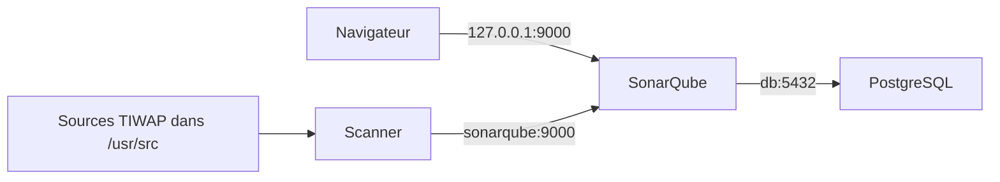

# TP NOVA SERVICES — Injection SQL et SonarQube

Laboratoire commencé le 15 octobre 2026 ; résultats examinés le 16 octobre 2026.

## Architecture et périmètre

Le fichier `compose.yaml` déploie PostgreSQL (`db`), SonarQube (`sonarqube`)
et le service d'analyse ponctuelle (`scanner`). Ils communiquent sur `sonarnet`.
Le navigateur accède à `http://127.0.0.1:9000`, tandis que le scanner utilise
`http://sonarqube:9000`, résolu par le DNS du réseau Docker.



Les volumes nommés conservent la base PostgreSQL, les données, les extensions
et les journaux SonarQube. Le conteneur PostgreSQL ne publie aucun port.
Le Compose de TIWAP n'est pas utilisé : l'application Flask vulnérable reste arrêtée.
Les mots de passe et jetons locaux sont conservés hors des livrables dans `.env`,
qui est ignoré par Git.

## Procédure

Depuis le dossier du TP, avec Docker Desktop démarré :

```powershell
docker compose up -d db sonarqube
Invoke-RestMethod http://127.0.0.1:9000/api/system/status
```

Attendre le statut `UP`, se connecter à SonarQube et créer un jeton d'analyse.
La configuration est définie dans `TIWAP/sonar-project.properties`.

```powershell
# SONAR_TOKEN est défini dans .env, ignoré par Git.
docker compose run --rm scanner
python -m unittest discover -s tests -v
```

La branche de correction locale est `fix/sql-injection-lab`.
Les résultats existants ont été exportés avant la correction dans
`preuves/sonarqube-initial.json`. La copie initiale du fichier SQL est conservée
dans `preuves/SQLi-avant.py.txt`. Pour reproduire l'analyse de ce code initial
après la correction locale, monter cette copie par-dessus le seul fichier concerné :

```powershell
docker compose run --rm -v "${PWD}/preuves/SQLi-avant.py.txt:/usr/src/vulnerabilities/SQLi.py:ro" scanner
```

La seconde analyse du code corrigé a été exécutée le 16 octobre 2026 avec le montage
habituel de `TIWAP`. Elle est décrite en section 12. Aucun statut d'anomalie n'a été
modifié manuellement dans SonarQube.

## 8.1. Examiner les résultats de l'analyse initiale

### Résultats observés

Projet : `tiwap` / TIWAP. Serveur : SonarQube Community Build `26.10.0.133078`.
Les données ci-dessous proviennent des API du serveur local, consultées le
16 octobre 2026, et de la capture fournie [analyseV1.png](preuves/analyseV1.png).
L'export des résultats, métriques et descriptions des règles est disponible dans
[preuves/sonarqube-initial.json](preuves/sonarqube-initial.json).

| Mesure | Valeur observée |
| --- | --- |
| Anomalies distinctes | 51, toutes au statut `OPEN` dans l'export |
| Impact sécurité, affichage du tableau de bord | 30 ; note E |
| Impact fiabilité, affichage du tableau de bord | 21 ; note D |
| Impact maintenabilité, affichage du tableau de bord | 7 ; note A |
| Classification classique de l'API | 30 `VULNERABILITY`, 5 `BUG`, 16 `CODE_SMELL` |
| Security Hotspots | 0 selon la métrique `security_hotspots` et la capture ; rubrique marquée « Deprecated » dans cette version |
| Couverture affichée | 0,0 % ; aucun rapport de couverture des tests isolés n'est importé |
| Duplication | 6,2 % |
| Lignes de code, métrique `ncloc` | 2 368 |

Les impacts peuvent se cumuler : une même anomalie peut contribuer à la fois à
la fiabilité et à la maintenabilité. Il ne faut donc pas additionner 30, 21 et 7
pour obtenir le nombre d'anomalies distinctes. Les catégories classiques
`BUG` et `CODE_SMELL` ne correspondent pas directement aux compteurs d'impacts.

La liste détaillée des hotspots renvoie `403` avec le jeton utilisé ; le compteur
zéro est établi par la métrique accessible et la capture, sans prétendre avoir
effectué une revue de hotspots. Certaines autres métadonnées du projet sont
également inaccessibles avec ce jeton ; les erreurs d'accès sont conservées
dans l'export. Aucun droit ni statut de résultat n'a été changé.

### Anomalies intéressantes et qualification

Le tableau retient des résultats représentatifs des trois familles d'impacts.
Les 51 résultats complets sont conservés dans l'export JSON. Les identifiants
ci-dessous sont les références exactes renvoyées par SonarQube. Les recommandations
sont résumées depuis les descriptions des règles fournies par le même serveur.
« Confirmé » désigne ici un constat dans le code ; cela ne vaut pas démonstration
d'exploitation de l'application, qui n'a pas été lancée pour cette revue.

| Identifiant SonarQube | Fichier et ligne | Règle | Type | Impact potentiel | Confiance après lecture du code | Recommandation de l'outil et action proposée |
| --- | --- | --- | --- | --- | --- | --- |
| `cbf8e560-89ae-46d7-895b-85cd2d8fd5d9` | `TIWAP/helper/auth.py:39` | `python:S5659` | Vulnérabilité ; sécurité haute | Usurpation de l'identité contenue dans un JWT modifié | Élevée : `verify_signature=False` ; le cookie utilisateur atteint cette fonction depuis `app.py:815` | Corriger : vérifier systématiquement la signature avec une clé adaptée et une liste d'algorithmes autorisés ; refuser les jetons invalides. |
| `88e0f0be-8566-4e12-9d99-2d7dfff94b15` | `TIWAP/app.py:29` | `python:S6779` | Vulnérabilité ; sécurité bloquante | Falsification de données protégées par la clé Flask si elle est connue | Élevée : clé littérale dans la configuration, sans reproduire sa valeur | Corriger : renouveler la clé exposée et charger la nouvelle depuis un gestionnaire de secrets ou l'environnement. |
| `1b547159-e3f6-43e7-9867-ff2d4b0a45e7` | `TIWAP/app.py:731` | `python:S4830` | Vulnérabilité ; sécurité haute | Interception ou falsification d'une réponse HTTPS | Élevée : `requests.get(..., verify=False)` ; deux autres occurrences aux lignes 723 et 728 | Corriger : rétablir la validation des certificats ; configurer une autorité de confiance pour les certificats internes. |
| `2387f3ff-69d2-4dab-ada5-70d5a52803c0` | `TIWAP/vulnerabilities/SQLi.py:151` | `python:S4790` | Vulnérabilité ; sécurité haute | Recherche accélérée des mots de passe à partir de leurs empreintes | Élevée : `secure_login` compare une empreinte MD5 du mot de passe | Corriger : utiliser un hachage de mots de passe lent et salé, tel qu'Argon2, scrypt, bcrypt ou PBKDF2 ; prévoir la migration des empreintes existantes. Cette alerte concerne le hachage, pas l'injection SQL. |
| `c2a7485f-fe46-4953-8ac7-1462413c47f7` | `TIWAP/helper/mongodb_manager.py:69` | `python:S2068` | Vulnérabilité ; sécurité moyenne | Réutilisation d'un identifiant de laboratoire connu si ces données sont déployées | Présence confirmée d'une empreinte de mot de passe codée en dur dans la réinitialisation ; exposition à évaluer selon le déploiement | Examiner puis corriger pour un usage réel : supprimer les identifiants fixes, renouveler les secrets concernés et externaliser leur initialisation. |
| `5c0210c2-3b90-456d-a2d2-9d41780ea0ac` | `TIWAP/app.py:913` | `python:S4507` | Vulnérabilité ; sécurité faible selon l'outil | Divulgation d'informations de débogage si l'application est exécutée ainsi | Élevée sur la configuration : `debug=True` dans le point de démarrage | Corriger avant déploiement : désactiver le débogage et utiliser un serveur adapté à la production. |
| `bd8fee19-c153-485e-9d79-18f0c4166fc8` | `TIWAP/app.py:913` | `python:S8392` | Vulnérabilité ; sécurité bloquante | Exposition du serveur sur toutes les interfaces de son environnement d'exécution | Élevée sur le code : `host='0.0.0.0'` ; exposition effective non testée | Examiner le besoin réseau ; pour un lancement local, limiter l'écoute à `127.0.0.1`. Documenter toute exposition nécessaire dans un déploiement encadré. |
| `274d5927-a28a-46bb-93b8-7e1bff4feebc` | `TIWAP/app.py:848` | `python:S3330` | Vulnérabilité ; sécurité faible | Lecture du cookie JWT par un script injecté | Élevée : `set_cookie` sans argument `httponly` | Corriger : définir `httponly=True` pour les cookies d'authentification ; occurrences analogues aux lignes 880 et 898. |
| `ccda1d0f-83d1-4dfe-8377-3232974fc861` | `TIWAP/app.py:848` | `python:S2092` | Vulnérabilité ; sécurité faible | Transmission du cookie sur une connexion HTTP non chiffrée | Élevée : `set_cookie` sans argument `secure` | Corriger : définir `secure=True` et servir les échanges concernés en HTTPS ; occurrences analogues aux lignes 880 et 898. |
| `cdbf6ed9-7ca0-49e7-80a7-b633ce9cc98d` | `TIWAP/app.py:28` | `python:S4502` | Vulnérabilité ; sécurité haute | Déclenchement d'une action par le navigateur d'un utilisateur à son insu | À examiner : l'initialisation Flask ne montre pas de protection CSRF globale ; le contrôle manuel de la route pédagogique `/csrf` ne suffit pas à établir une couverture globale | Examiner les opérations modifiant l'état et activer une protection CSRF adaptée, avec des jetons liés à la session et vérifiés côté serveur. |
| `9f6bbe36-ade9-46b1-90de-4437efa95129` | `TIWAP/app.py:40` | `python:S5247` | Vulnérabilité ; sécurité moyenne | Interprétation de contenu HTML utilisateur et risque XSS | Configuration confirmée : `Environment()` sans échappement automatique ; utilisé dans la route de gabarits aux lignes 778 et 787 | Corriger : activer l'échappement adapté au HTML. Examiner aussi la construction de gabarits avec les données utilisateur, qui constitue un risque distinct. |
| `f17f9f18-3f67-4be1-9ba4-634e9aba6b89` | `TIWAP/Dockerfile:1` | `docker:S6471` | Vulnérabilité ; sécurité faible | Privilèges trop élevés dans un éventuel conteneur TIWAP compromis | Absence d'instruction `USER` confirmée ; l'outil signale l'utilisateur root par défaut de l'image | Corriger avant construction : créer un utilisateur non privilégié et le sélectionner avec `USER`. |
| `65e922ff-ea7c-4e3e-806c-e97f52f93cb9` | `TIWAP/Dockerfile:4` | `docker:S6470` | Vulnérabilité ; sécurité haute | Inclusion involontaire de fichiers sensibles dans une image | Élevée sur le risque de copie : `COPY . /app` inclut tout le contexte, qui contient notamment des fichiers de clés du laboratoire ; image non construite pour la revue | Corriger : copier explicitement les fichiers nécessaires et exclure les ressources sensibles du contexte de construction. |
| `15ca62ea-737e-4d38-badb-d2dcc24d171e` | `TIWAP/templates/dashboard_layout.html:19` | `Web:S5725` | Vulnérabilité ; sécurité faible | Chargement d'une ressource distante modifiée | Absence d'attribut d'intégrité signalée ; l'exploitation suppose une altération de la ressource distante | Corriger : ajouter une empreinte SRI adaptée et `crossorigin="anonymous"` aux ressources statiques concernées. |
| `cb97fb8c-d89e-4e61-83c4-d531cf3e28f5` | `TIWAP/app.py:760` | `python:S2245` | Vulnérabilité ; sécurité moyenne selon l'outil | Prédictibilité si la valeur aléatoire était utilisée pour une décision de sécurité | Faible pour une vulnérabilité exploitable ici : `randint(10, 50)` simule un stock affiché, sans secret ni jeton identifié dans ce chemin | Documenter cet usage de simulation. La recommandation de l'outil est d'utiliser un générateur cryptographique pour les usages de sécurité ; aucune correction de sécurité n'est justifiée par ce seul appel. |
| `1feb4b91-8106-469a-95a4-1837f36cacd5` | `TIWAP/helper/mongodb_manager.py:20` | `python:S1656` | Bug ; fiabilité moyenne | Branche d'erreur difficile à interpréter et traitement prévu potentiellement manquant | Auto-affectation `username = username` confirmée ; aucun comportement supplémentaire n'est effectué | Corriger : supprimer l'affectation inutile ou définir explicitement le traitement attendu après l'échec JSON. Même constat à la ligne 40. |
| `5fcbfa48-fe86-4af9-9061-e148f718b730` | `TIWAP/helper/auth.py:12` | `python:S6903` | Code smell ; fiabilité haute et maintenabilité moyenne | Ambiguïtés lors de conversions ou comparaisons de dates de validité des JWT | Usage de `datetime.utcnow()` confirmé ; pas de dysfonctionnement d'expiration démontré | Corriger : utiliser des dates UTC avec fuseau, par exemple `datetime.now(timezone.utc)` ; vérifier les six occurrences relevées par la règle. |
| `75b7de92-521d-4c02-9fe0-ccf071692675` | `TIWAP/templates/vulnerabilities/sql-injection.html:31` | `Web:S6853` | Code smell ; fiabilité moyenne | Formulaire insuffisamment décrit pour les lecteurs d'écran | Élevée : `<label for="userid"></label>` est vide malgré son association au champ | Corriger : donner au label un texte décrivant le champ, par exemple « Identifiant utilisateur ». Ce résultat HTML ne signale pas une injection SQL. |
| `3d0c6d9e-1d9d-44e1-bbff-e2ea550a5b8c` | `TIWAP/templates/vulnerabilities/xml-external-entities.html:20` | `Web:S6850` | Code smell ; fiabilité moyenne et maintenabilité faible | Structure des titres difficile à interpréter par les technologies d'assistance | Élément `<h6>` initialement vide confirmé ; son contenu peut être mis à jour ensuite par le script | Corriger : fournir un titre accessible ou choisir un élément de message adapté si le contenu n'est pas un titre. |
| `1cf7098b-9b1d-4c19-85bd-6fbb17a53b58` | `TIWAP/templates/settings.html:15` | `Web:S5256` | Bug ; fiabilité moyenne | Tableau difficile à comprendre sans perception visuelle de sa mise en page | En-tête de tableau constitué de cellules `<td>`, sans `<th>` | Corriger : utiliser des cellules d'en-tête `<th>` et leur association aux cellules de données, par exemple avec `scope`. |

Les actions du tableau sont des propositions de traitement ; seules les deux
lignes de la requête `sqli_medium` ont été corrigées dans cet exercice. Les autres
anomalies restent à traiter selon la priorité et le contexte métier.

### Injection SQL non signalée

Aucun des 51 résultats exportés ne signale la requête de `sqli_medium` comme
une injection SQL. La règle `python:S2077` existe dans le catalogue du serveur
(requêtes SQL construites dynamiquement), mais aucun résultat de cette règle
n'apparaît dans cette analyse. La vérification effectuée lors de la seconde analyse
confirme que cette règle est active dans le profil Python utilisé, `Sonar way core`.
La reconnaissance de ce chemin par l'analyseur reste à examiner ; son absence
ne peut pas être expliquée par une règle inactive lors de la seconde analyse.

Le résultat `python:S4790` dans `SQLi.py:151` concerne MD5, et le résultat
`Web:S6853` dans le formulaire concerne son label vide. Aucun de ces deux
résultats ne constitue une détection de l'injection SQL étudiée.

| Identifiant | Fichier et ligne avant correction | Règle | Type | Impact potentiel | Confiance | Action |
| --- | --- | --- | --- | --- | --- | --- |
| `MANUEL-SQL-01` — référence locale, sans identifiant SonarQube | `TIWAP/vulnerabilities/SQLi.py:40`, exécution ligne 42 | Aucune règle déclenchée sur cette requête dans l'export | Injection SQL confirmée manuellement | Lecture d'autres lignes de `users` en modifiant le filtre `userid` | Élevée : chemin de données et reproduction SQLite en mémoire | Corriger avec des paramètres SQLite et conserver les tests de régression. |

L'absence d'alerte SQL ou de hotspot ne prouve donc pas l'absence de vulnérabilité.

## 9. Comprendre et retrouver l'injection SQL

### Recherche et chemin de données dans TIWAP

La recherche demandée a été effectuée avec l'équivalent `rg` sous PowerShell :

```powershell
rg -n 'execute\(|SELECT|request\.args|request\.form' TIWAP -g '*.py'
```

Le chemin retenu est le suivant :

1. **Point d'entrée** : route `/sql-injection`, `TIWAP/app.py:136`, protégée par
   `@is_logged`. Lorsque `session['level'] == 1`, la ligne 152 lit
   `userid = request.form.get('userid')`.
2. **Transmission** : la ligne 153 appelle `SQLi.sqli_medium(userid=userid)`.
   Le formulaire affiche une liste d'identifiants, mais une contrainte HTML
   ne garantit pas la valeur reçue dans une requête HTTP.
3. **Construction vulnérable** : `TIWAP/vulnerabilities/SQLi.py:40` convertit
   l'entrée en chaîne puis l'interpole dans le SQL avec `%`.
4. **Exécution** : la ligne 42 passe cette chaîne complète à `cur.execute(stmt)`.
5. **Résultat** : la fonction retourne `fetchall()` ; la route transmet ces lignes
   au gabarit à la ligne 155 de `app.py`.

Le décorateur d'authentification ne sépare pas les valeurs de la commande SQL.
Le constat porte sur la possibilité de contourner le filtre de la requête sur
ce chemin accessible à un utilisateur connecté ; aucun contournement du login
n'est démontré par cet exercice.

### Mécanisme et preuve locale

Pour une valeur normale `1`, le code initial produit :

```sql
SELECT userid, username FROM users WHERE userid='1'
```

Avec l'entrée de test `1' OR '1'='1`, il produit :

```sql
SELECT userid, username FROM users WHERE userid='1' OR '1'='1'
```

La seconde condition est toujours vraie. Dans la base synthétique en mémoire,
la fonction renvoie alors Alice et Bob au lieu de respecter un identifiant précis.
L'apostrophe seule provoque aussi une erreur de syntaxe. La conversion `str()`
ne protège pas la structure SQL : la donnée reste intégrée au texte exécuté.
Ces constats sont enregistrés dans `preuves/tests-avant.txt`.

### Requêtes à ne pas classer automatiquement comme vulnérables

`TIWAP/helper/db_manager.py:28` utilise déjà `WHERE username = ?` avec
`(username,)`. La ligne 40 fait de même pour la recherche de connexion.
La ligne 84 transmet également l'identifiant dans un tuple de paramètres.
Sur ces appels, les valeurs utilisateur ne sont pas interpolées dans le texte SQL.
Cela justifie d'écarter ce mécanisme précis d'injection sur ces requêtes,
sans conclure que l'ensemble du gestionnaire ou de l'application est sécurisé.

## 10. Corriger la requête SQL

### Correction appliquée à la fonction réelle

Code vulnérable dans `sqli_medium` :

```python
stmt = "SELECT userid, username FROM users WHERE userid='%s'" % (str(userid))
result = cur.execute(stmt)
```

Code corrigé :

```python
stmt = "SELECT userid, username FROM users WHERE userid = ?"
result = cur.execute(stmt, (str(userid),))
```

Le marqueur `?` convient au pilote `sqlite3`. Le tuple à un élément transmet
la valeur séparément de la structure SQL. `str(userid)` conserve la conversion
effectuée par la fonction d'origine. Les colonnes retournées, le type de retour
et la gestion des erreurs SQLite sont conservés. La modification ne porte que
sur `sqli_medium`.

Le marqueur `?` n'est pas entouré d'apostrophes dans le SQL. La virgule du tuple
`(str(userid),)` est nécessaire pour transmettre un paramètre. Les entrées
contenant des apostrophes sont désormais des valeurs de recherche ordinaires.
Les tests vérifient à la fois les recherches normales et le refus de l'effet
d'injection.

### Bonnes pratiques complémentaires

- Valider aussi le format métier de `userid`, sans remplacer le paramétrage SQL.
- Limiter les privilèges du compte de base et, pour SQLite, les droits sur son fichier.
- Retourner à l'utilisateur un message générique en cas d'erreur de base et journaliser
  le détail côté serveur. Le retour direct de l'exception SQLite dans cette fonction
  reste un point à traiter au-delà de la correction ciblée.
- Conserver les tests de régression et les exécuter lors des modifications de ce chemin.
- Si un futur besoin choisit un nom de table ou de colonne, utiliser une liste blanche
  d'identifiants autorisés : les paramètres de valeurs ne remplacent pas cette validation.

## 11. Branche de correction et tests de non-régression

La correction est isolée dans la branche locale `fix/sql-injection-lab` de TIWAP.
La vérification de `git diff` confirme que seul `vulnerabilities/SQLi.py` est modifié
par rapport au code suivi : deux lignes supprimées, deux lignes ajoutées,
dans la seule fonction `sqli_medium`. `git diff --check` ne signale aucune erreur.
Le fichier de configuration `sonar-project.properties` a également été ajouté.

`tests/test_sql_injection.py` charge le vrai module SQL de TIWAP en remplaçant
son gestionnaire de base par une connexion SQLite en mémoire. Les tests ne
démarrent pas Flask et n'ouvrent pas le fichier `TIWAP.db`.

| Cas | Résultat attendu | Avant correction | Après correction |
| --- | --- | --- | --- |
| Identifiant `1` | Uniquement Alice | Réussi | Réussi |
| Identifiant inexistant `999` | Aucune ligne | Réussi | Réussi |
| Identifiant contenant une apostrophe `1'` | Aucune ligne, sans erreur SQL | Échec : erreur SQL renvoyée | Réussi |
| Entrée `1' OR '1'='1` | Aucune ligne | Échec : Alice et Bob sont renvoyés | Réussi |

Les données Alice et Bob sont des données synthétiques de test.
Les preuves sont enregistrées dans `preuves/tests-avant.txt` et `preuves/tests-apres.txt`.
Avant correction : 4 tests, 2 échecs. Après correction : 4 tests, aucun échec.
Le fichier `preuves/SQLi-avant.py.txt` conserve le code initial pour comparaison.
Le diff ciblé est disponible dans `preuves/correction-sql.patch`.

## 12. Seconde analyse et comparaison avant / après

L'image du scanner était déjà disponible localement. La commande exécutée a été :

```powershell
docker compose -f compose.yaml run --rm --no-deps --pull never scanner
```

Les deux services étaient déjà démarrés et SonarQube avait le statut `UP`.
Le jeton de `.env` a été accepté. Le scanner a terminé avec `EXECUTION SUCCESS`
et un code de sortie `0`, puis le traitement serveur a atteint `SUCCESS`
le 16 octobre 2026 à 09 h 51, heure de Paris.

- Projet analysé : `tiwap` / TIWAP.
- Tâche serveur : `646baf3d-9bec-421d-ab41-7d63a1febcd1`.
- Nouvelle analyse : `88a29a71-c5bd-4a91-b22a-1772fc06ba46`.
- Journal : [preuves/scan-apres.log](preuves/scan-apres.log).
- Résultats après correction : [preuves/sonarqube-apres.json](preuves/sonarqube-apres.json).
- Comparaison structurée : [preuves/comparaison.json](preuves/comparaison.json).

| Critère | Avant | Après |
| --- | --- | --- |
| Anomalie étudiée | Injection SQL confirmée manuellement dans `sqli_medium`, sans identifiant SonarQube | Requête paramétrée ; les entrées de test ne modifient plus la structure SQL |
| Règle concernée | Aucun résultat `python:S2077` sur cette requête | Aucun résultat `python:S2077` ; règle active dans le profil utilisé |
| Emplacement | `TIWAP/vulnerabilities/SQLi.py:40`, exécution ligne 42 | Même fonction et mêmes lignes |
| Code vulnérable présent dans la fonction ciblée ? | Oui, interpolation `%s` de l'entrée utilisateur | Non : texte SQL fixe et paramètre séparé |
| Construction SQL dans `sqli_medium` | Interpolation `%s` | Marqueur `?` et tuple de paramètres séparé |
| Résultat SonarQube sur la fonction | Aucun résultat SQL dans l'export initial des 51 anomalies | Aucun résultat SQL dans l'export après correction ; aucune disparition d'alerte revendiquée |
| Anomalies distinctes du projet | 51 | 51 ; mêmes identifiants et mêmes statuts, aucun ajout ni retrait |
| Impacts sécurité / fiabilité / maintenabilité | 30 / 21 / 7 | 30 / 21 / 7 |
| Security Hotspots, compteur | 0 | 0 |
| Tests de régression | 2 réussites, 2 échecs | 4 réussites, aucun échec |
| Risque résiduel | Injection démontrée dans la fonction | Les entrées testées ne modifient plus la structure de la requête ; les autres fonctions vulnérables du laboratoire ne sont pas corrigées par cet exercice |

### Vérifications expliquant les résultats inchangés

1. **Fichier modifié** : le diff ne touche que `sqli_medium`. L'empreinte SHA-256
   de ce fichier correspond à celle de la version ayant réussi les tests ; elle
   est conservée dans l'export après correction.
2. **Répertoire analysé** : le montage Compose résout bien le dossier local
   `C:/Users/morli/Perso/tp-sonarqube-nova/TIWAP` vers `/usr/src`. Le journal confirme
   cette base, le projet `tiwap` et l'analyse de 14 fichiers Python. `SQLi.py`
   est également cité parmi les fichiers modifiés pour lesquels le suivi Git
   n'a pas fourni d'informations de responsabilité.
3. **Règle et profil** : le journal identifie `Sonar way core` pour Python.
   Les API du serveur confirment l'activation de `python:S2077` dans ce profil.
   Son absence de résultat sur ce chemin ne démontre donc pas son innocuité.
4. **Type de résultat** : le compteur des hotspots reste à zéro. L'unique
   vulnérabilité encore comptée par SonarQube dans `SQLi.py` concerne MD5
   (`python:S4790`, ligne 151), qui n'a pas été modifié par cette correction.
5. **Journal** : le scanner et le traitement serveur ont réussi. Il existe
   toutefois des limites de l'analyse : version Python non précisée, absence
   d'informations Git sur le fichier modifié et avertissement de parsing JavaScript
   dans `templates/vulnerabilities/xml-external-entities.html`, ligne 25.

Le Quality Gate renvoie `OK` sur le nouveau code, avec `ignoredConditions=true`.
Ce résultat n'efface pas les 51 anomalies existantes et ne constitue pas une
validation globale de sécurité. La couverture affichée reste à 0 %, car aucun
rapport de couverture des tests isolés n'a été importé.

La conclusion sur la correction repose sur le code paramétré et les tests de
régression. Il serait incorrect d'annoncer une vulnérabilité SQL « résolue » dans
SonarQube alors que cette vulnérabilité n'y était pas signalée avant correction.

## 13. Fiche de traitement NOVA SERVICES

Cette fiche est une proposition pour le contexte métier du TP ; TIWAP reste
un laboratoire isolé, pas une application de production de NOVA SERVICES.

| Élément | Proposition |
| --- | --- |
| Référence | NOVA-SQL-01 |
| Actif | Application de gestion clients, par analogie avec la fonction étudiée |
| Défaut | Entrée utilisateur interpolée dans une requête SQLite |
| Confidentialité | Lecture non autorisée de lignes confirmée par le test |
| Intégrité / disponibilité | À évaluer selon les requêtes et les droits ; aucune modification ou suppression n'est démontrée par le test effectué |
| Priorité métier proposée | Haute si le chemin est exposé sur une application traitant des données clients ; le laboratoire seul n'est pas exposé |
| Responsable proposé | Équipe de développement de l'application, avec revue par le référent sécurité |
| Échéance proposée | Avant livraison ; au plus tard le 22 octobre 2026 dans le scénario du TP |
| Statut de traitement | Correction locale vérifiée dans la fonction ciblée ; clôture métier proposée après revue, sans prétendre clôturer une alerte SonarQube inexistante |
| Preuves de correction | `preuves/correction-sql.patch`, extraits avant/après et `preuves/tests-apres.txt` : 4 tests réussis |
| Vérification de l'analyse | Seconde analyse traitée avec succès ; `preuves/comparaison.json` documente les résultats inchangés |
| Risque résiduel | Autres fonctions et autres familles de vulnérabilités à examiner séparément |

La priorité proposée prend en compte des données clients potentiellement critiques,
l'exposition d'une application de production, un défaut reproductible sur des
données de test et son impact sur la confidentialité. Les tests ne démontrent
aucune modification ni suppression de données. Dans ce laboratoire, l'absence
d'exécution de TIWAP et l'usage de données synthétiques réduisent l'exposition ;
ce contexte ne doit pas être confondu avec celui d'une application publique.

## 13.2. Indicateurs de pilotage

Les indicateurs suivants constituent une proposition de tableau de bord.
Ils ne sont pas présentés comme des mesures déjà disponibles chez NOVA SERVICES.

| Indicateur | Définition | Source | Fréquence | Responsable | Décision permise |
| --- | --- | --- | --- | --- | --- |
| Vulnérabilités ouvertes par priorité | Nombre de défauts confirmés non clôturés, regroupés par priorité métier | Résultats qualifiés et tickets | Hebdomadaire | Référent sécurité | Affecter les corrections prioritaires |
| Défauts hauts / critiques en retard | Nombre de défauts ouverts dont la priorité est haute ou critique et l'échéance dépassée | Tickets et échéances | Quotidienne | Responsable applicatif | Escalader et réaffecter les ressources |
| Délai médian de correction | Médiane du temps entre confirmation du défaut et vérification de sa correction | Historique des tickets et preuves | Mensuelle | Responsable de développement | Ajuster la capacité et les délais de traitement |
| Corrections revérifiées | Corrections accompagnées d'une nouvelle analyse et de tests réussis / corrections annoncées, en pourcentage ; non applicable si le dénominateur vaut zéro | Analyses, tests et tickets | Hebdomadaire | Référent qualité | Refuser une clôture sans preuve |

## 15. Dossier de livrables

Le dossier `livrables/` et l'archive `livrables-tp-sonarqube-nova.zip` regroupent
les pièces à remettre. Les fichiers d'environnement, les jetons, les mots de passe,
le dépôt Git et les clés du laboratoire TIWAP ne font pas partie de ce dossier.

| Livrable | Pièce fournie |
| --- | --- |
| Architecture et configuration sans secret | `compose.yaml`, `sonar-project.properties` et début de ce compte rendu |
| Capture de l'interface | `preuves/analyseV1.png`, capture initiale fournie du tableau de bord ; les exports identifient le projet `tiwap` |
| Tableau initial d'anomalies | Section 8.1 et `preuves/sonarqube-initial.json` |
| Code vulnérable, code corrigé et explication | Section 10, `preuves/sqli-medium-avant.py.txt`, `preuves/sqli-medium-apres.py.txt`, `preuves/correction-sql.patch` |
| Tests de non-régression | `tests/test_sql_injection.py`, `preuves/tests-avant.txt`, `preuves/tests-apres.txt` |
| Comparaison avant/après et analyse relancée | Section 12, `preuves/comparaison.json`, `preuves/sonarqube-apres.json`, `preuves/scan-apres.log` |
| Fiche de traitement et indicateurs | Sections 13 et 13.2 |
| Questions de compréhension | Section 16 |
| Conclusion et nettoyage | Section 17 et `preuves/arret-laboratoire.txt` |

Le `README.md` du dossier explique comment reconstituer le dépôt complet pour
rejouer les tests et les analyses. Les exemples de code intégrés aux descriptions
des règles dans les exports sont des exemples génériques de SonarQube, pas les
secrets du laboratoire.

## 16. Réponses aux questions de compréhension

1. **PostgreSQL** conserve les données structurées de SonarQube indépendamment
   du cycle de vie de son conteneur : projets, analyses et configuration.
2. **Adresses réseau** : `localhost` désigne la machine ou le conteneur depuis
   lequel la requête part. Le scanner doit utiliser le nom Docker `sonarqube`.
3. **SAST et test dynamique** : le SAST examine le code sans lancer l'application ;
   un test dynamique examine son comportement pendant son exécution.
4. **Interpolation SQL** : les données utilisateur deviennent une partie du texte
   interprété comme du SQL et peuvent en modifier les conditions.
5. **Paramétrage** : le pilote reçoit les valeurs séparément de la commande SQL
   et les traite comme des données.
6. **Validation** : elle applique les contraintes métier, mais ne remplace pas
   la séparation entre commande et valeurs assurée par le pilote SQL.
7. **Qualification** : une alerte peut nécessiter une revue de son chemin de données,
   de ses protections et de son contexte. Un hotspot appelle une revue manuelle.
8. **Absence d'alerte SQL** : vérifier la configuration, les fichiers analysés et les
   règles disponibles, puis documenter la revue et les tests sans inventer d'alerte.
9. **Priorité** : considérer exposition, criticité des données, exploitabilité,
   conséquences métier et mesures compensatoires.
10. **Comptage brut** : il ne reflète ni la gravité, ni l'exposition, ni la couverture
    de l'outil, ni l'efficacité réelle des corrections.
11. **CI/CD** : stocker le jeton dans le gestionnaire de secrets, limiter ses droits,
    sa durée et son accès aux branches autorisées, et éviter sa présence dans les
    journaux, artefacts ou captures. Protéger aussi l'accès réseau à SonarQube.
12. **Preuve durable** : associer la revue du diff, des tests de régression,
    une nouvelle analyse et leur exécution régulière lors des changements.

## 17. Conclusion et nettoyage du laboratoire

Une analyse statique dépend des règles, de la version de l'analyseur et de sa
capacité à suivre les données. L'absence d'une alerte n'établit pas l'absence
de vulnérabilité. Les tests présentés couvrent une seule fonction et ne valent
pas audit global de TIWAP.

La correction ciblée empêche les entrées de test de transformer la requête SQL.
Les quatre tests passent, tandis que les compteurs SonarQube restent inchangés :
cette différence illustre la nécessité de combiner analyse statique, revue du code
et tests. Les autres fonctions vulnérables de TIWAP restent hors de cette correction.

L'arrêt du laboratoire a été effectué après l'export des résultats avec :

```powershell
docker compose down
```

La commande a réussi : les deux conteneurs du laboratoire et son réseau ont été
retirés. Les quatre volumes nommés PostgreSQL/SonarQube sont conservés, avec
l'historique des analyses. La preuve est dans `preuves/arret-laboratoire.txt`.
L'option `-v`, qui effacerait ces données, n'a pas été utilisée.

Pour consulter à nouveau les résultats :

```powershell
docker compose up -d db sonarqube
```

Le jeton local n'a pas été révoqué afin de permettre d'éventuelles vérifications
supplémentaires. Lorsqu'il n'est plus utile, le révoquer dans **Mon compte → Sécurité**.
Il reste exclu du dossier de livrables et de l'archive.
