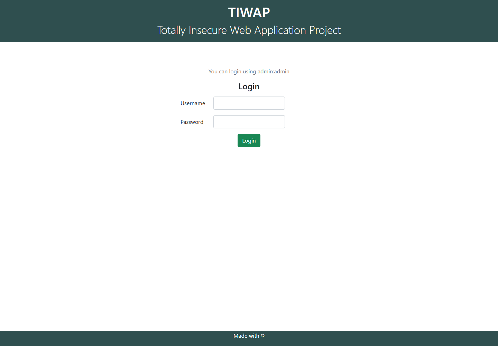

# TP3 — DAST avec OWASP ZAP

**Contexte :** NOVA SERVICES — laboratoire TIWAP local.
**Date de préparation :** 16 octobre 2026.
**État :** scan local terminé, rapports vérifiés et analyse rédigée. Intégration GitHub Actions en cours dans `xMokiii/tp-sonarqube-nova`.

## 1. Objectif et méthode

L'objectif est d'examiner une application web exécutée, de qualifier les alertes
observées et de proposer leur traitement dans un contexte métier. TIWAP sert
uniquement de cible pédagogique ; les scénarios NOVA SERVICES ci-dessous sont
des analogies pour apprendre à prioriser.

Le périmètre est `http://app:5000` depuis le réseau Docker Compose et
`http://localhost:5001` depuis l'hôte. Le scan de référence est **anonyme** :
aucun contexte d'authentification ZAP n'est fourni. Il combine une exploration
limitée à deux minutes et une analyse passive des échanges accessibles.

## 2. Environnement et adaptations

- Windows avec Docker Desktop et son moteur Linux.
- Docker Engine 29.1.3, Compose v2.40.3-desktop.1, Git 2.49.0.windows.1.
- Source TIWAP : <https://github.com/tombstoneghost/TIWAP>, commit
  `1f9d2ac01b19c86ed20242fce5556ea77417d2a9`.
- Services Compose : `app` (Flask), `db` (MongoDB 4.4), `zap` (image officielle stable).
- Projet Compose `nova-tp3-zap`, distinct du projet `tiwap` déjà utilisé dans
  `tp-sonarqube-nova`. Le port hôte 5000 étant occupé par cet autre TP, le port
  web local est `127.0.0.1:5001` ; le port interne reste `app:5000`.
- Port MongoDB non publié sur l'hôte.
- Retrait de `ssl_context=context` au démarrage Flask pour suivre les URL HTTP
  imposées par l'énoncé. Ce changement décrit le protocole du laboratoire ; il
  ne constitue pas une mesure de durcissement de production.
- Rapports montés dans `/zap/wrk/`, exclus du versionnement par `.gitignore`.
- Healthcheck HTTP intégré de ZAP désactivé pour le mode `sleep infinity` :
  la disponibilité de TIWAP est vérifiée explicitement avant le scan.
- Les dépendances historiques et les vulnérabilités pédagogiques ne sont pas
  corrigées dans ce TP d'observation.

Il faut démarrer et vérifier TIWAP avant ZAP : le scanner évalue les réponses
HTTP d'une application en fonctionnement. L'absence de publication du port
MongoDB réduit les accès inutiles, car Flask joint déjà `db:27017` dans Docker.

## 3. Commandes et preuves

Commandes PowerShell depuis le dossier `TIWAP` :

```powershell
docker compose config --quiet
docker compose up -d --build
docker compose ps
docker compose exec -T zap zap-baseline.py -t http://app:5000 -m 2 -r zap-report.html -J zap-report.json
$LASTEXITCODE
```

Les fichiers de preuve sont disponibles dans `reports/` : rapports HTML/JSON,
journaux du scanner, état des services et réponses HTTP vérifiées.
Une capture du navigateur avec l'adresse locale visible complète la preuve du
fonctionnement de TIWAP.

Vérifications effectuées : la page d'accueil renvoie HTTP **200**, la connexion
`admin / admin` aboutit à `/dashboard` avec HTTP **200**, et ZAP obtient aussi
HTTP **200** sur `http://app:5000`. Sans authentification, `/sql-injection`
redirige vers l'accueil. Les résultats sont enregistrés dans
[`http-verification.json`](preuves/http-verification.json).

Le contrôle manuel d'une connexion invalide (`ZAP` / `ZAP`) reproduit une réponse
**500** contenant une trace et le fragment SQL `SELECT username, password FROM
users WHERE username = ?`. La divulgation est donc vérifiée dans cette réponse.
Le placeholder `?` de cette requête ne démontre pas une injection SQL. Le contrôle
de `/sitemap.xml` renvoie **404**, ce qui confirme qu'une URL mentionnée dans une
alerte d'en-tête n'est pas nécessairement une ressource existante.

Capture réelle de la page locale (navigateur sans barre d'adresse ; l'URL testée
est conservée dans la preuve HTTP ci-dessus) :



## 4. Résultats et qualification

Les observations ci-dessous proviennent du rapport réel ZAP **2.17.0** du
16 octobre 2026 : [HTML](preuves/zap-report.html), [JSON](preuves/zap-report.json),
[synthèse et empreintes des rapports](preuves/summary.json).
Le scan a produit **15 entrées d'alertes**, correspondant à **13 règles
distinctes** et **39 occurrences** : 4 entrées de risque moyen, 7 de risque faible
et 4 informationnelles. Aucune entrée de risque élevé n'y figure.
Une règle peut produire plusieurs sous-alertes : `90004` produit ici trois
variantes. Ces nombres ne représentent pas 15 vulnérabilités confirmées.

Le journal indique **19 URL**, **13 règles WARN**, **54 règles PASS** et
**aucun FAIL**. Le code de sortie est **2**. Un PASS signifie qu'une règle n'a
pas produit d'alerte dans le périmètre observé ; il ne garantit pas la sécurité
de fonctions non explorées. La présence et la fraîcheur des deux rapports ont
été vérifiées, ainsi que l'absence d'erreur de génération dans le journal final.

Avec la version utilisée, les chemins absolus du PDF sont préfixés une seconde
fois (`/zap/wrk/zap/wrk/...`) et empêchent l'écriture des rapports. La commande
retenue ci-dessus utilise donc des noms relatifs au dossier `/zap/wrk/`.

| Référence | Alerte réelle | Risque / confiance | URL et preuve | Qualification et action proposée |
|---|---|---|---|---|
| 10099 | Source Code Disclosure - SQL | Moyen / moyenne | `POST http://app:5000/login` ; fragment `SELECT username, password FROM users WHERE username`. | Divulgation de texte SQL dans une erreur ; vérifier la réponse brute et désactiver les traces de debug sur un service métier. Ce n'est pas une détection d'injection SQL. |
| 90022 | Application Error Disclosure | Faible / moyenne | `POST http://app:5000/login` ; `HTTP/1.0 500 INTERNAL SERVER ERROR`. | Examiner les traces et la gestion des identifiants inconnus. Prévoir des erreurs génériques côté client et des détails uniquement dans les journaux serveur. Lié au même échange que 10099 : ne pas compter automatiquement deux défauts indépendants. |
| 10020-1 | Missing Anti-clickjacking Header | Moyen / moyenne | `GET http://app:5000` ; protection de cadrage absente. La vérification HTTP confirme l'absence de CSP et de `X-Frame-Options`. | Confirmer les usages légitimes en iframe et les opérations sensibles avant de conclure à l'impact. Proposer `frame-ancestors` adapté dans CSP ou un `X-Frame-Options` approprié. |
| 10038-1 | Content Security Policy (CSP) Header Not Set | Moyen / élevée | Exemples ZAP : `/sitemap.xml`, `/app/helper/db_manager.py` et un chemin Flask, avec réponses d'erreur. L'accueil est aussi dépourvu de CSP selon le contrôle HTTP. | Une alerte sur une URL ressemblant à un fichier source ne signifie pas que ce fichier a été téléchargé : vérifier son statut et son contenu. Définir une CSP adaptée aux ressources réellement utilisées, y compris sur les pages d'erreur. L'absence de CSP ne prouve pas une XSS. |
| 10202 | Absence of Anti-CSRF Tokens | Moyen / faible | `GET http://app:5000` ; `<form method="post" action="/login">`, champs `username` et `password`. | ZAP ne reconnaît pas de jeton. Examiner le scénario de login CSRF, les cookies, la validation d'origine et les contrôles serveur avant de confirmer l'exploitabilité. Une protection CSRF du framework est une correction possible. |
| 10021 | X-Content-Type-Options Header Missing | Faible / moyenne | Accueil, `/index.css`, `/robots.txt` et une ressource du debugger ; en-tête `nosniff` absent. | Vérifier les types MIME et les ressources servies, puis proposer `X-Content-Type-Options: nosniff` à l'application ou au proxy et contrôler les réponses d'erreur. |

Autres entrées réellement présentes dans le JSON :

- `90004-1`, `90004-2`, `90004-3` : politiques CORP, COEP et COOP absentes ou
  invalides (faible, confiance moyenne). Leur configuration dépend des besoins
  de partage des ressources et des intégrations ; ne pas appliquer toutes les
  valeurs recommandées sans vérification fonctionnelle.
- `10063-1` : Permissions Policy Header Not Set (faible, confiance moyenne).
- `10036-2` : version serveur divulguée, dont la preuve est
  `Werkzeug/2.0.3 Python/3.6.15` (faible, confiance élevée).
- `10111` : Authentication Request Identified (informationnel, confiance élevée).
- `10109` : Modern Web Application (informationnel, confiance moyenne).
- `10027` : Information Disclosure - Suspicious Comments (informationnel,
  confiance moyenne). Le commentaire JavaScript `// Prevent page from refreshing.`
  correspond à un mot-clé banal ; il ne démontre pas une fuite sensible. Une autre
  occurrence provient de la trace d'erreur et doit être étudiée dans ce contexte.
- `10049-3` : Storable and Cacheable Content (informationnel, confiance moyenne).
  Vérifier d'abord si le contenu comporte des données personnelles ou de session.

Les constats `10111` et `10109` décrivent la surface explorée et ne sont pas
des vulnérabilités à corriger en tant que telles.

**Injection SQL : aucune injection SQL n'est détectée ni confirmée par ce scan.**
L'alerte `10099` porte sur la divulgation de texte SQL dans une réponse, pas sur
l'exécution d'une injection. Une confirmation de SQLi nécessiterait une revue
de code et des tests contrôlés distincts dans le laboratoire.

## 5. Pourquoi vérifier une alerte

Une alerte correspond à l'application d'une règle du scanner à un échange.
Le constat, la possibilité d'exploitation et l'impact métier ne se confondent
pas. Il faut vérifier l'URL, la réponse brute, le type de contenu et le niveau
de confiance, puis examiner l'authentification, les données et les protections
existantes. Un même défaut peut présenter des conséquences différentes selon
qu'il concerne une page publique sans données ou une opération authentifiée.

Une correction se vérifie par un contrôle ciblé de la réponse HTTP et un nouveau
scan du même périmètre. La disparition d'une alerte sur une page devenue
inaccessible ne prouve pas la correction du défaut.

### Comparaison avec l'injection SQL et le SAST

La revue du code local montre que `sqli_low` et `sqli_medium`, dans
`vulnerabilities/SQLi.py`, interpolent les valeurs reçues dans une chaîne SQL
avant `cur.execute(stmt)`. La route `/sql-injection` de `app.py` est protégée
par le décorateur `@is_logged` : le scan anonyme ne bénéficie pas de la session
utilisée pour la vérification manuelle du compte `admin`.

Un contrôle SAST peut examiner cette construction de requête dans le code.
Le présent baseline ne teste pas activement l'exploitation de ce chemin.
Les preuves du TP précédent sont maintenant disponibles dans le dépôt GitHub
retenu : `preuves/comparaison.json` rapporte 51 anomalies SonarQube avant et
après la correction ciblée, sans alerte SQL sur `sqli_medium`. La revue de code
et les tests SQLite avaient confirmé cette injection ; les quatre tests passent
après paramétrage de la requête. Ce résultat illustre aussi les limites du SAST.
Le laboratoire TP3 utilise ici la version pédagogique amont ; la correction
SQL du TP précédent est conservée séparément dans ses preuves et n'est pas
présentée comme appliquée à cette copie de TIWAP.

Référence : [comparaison du TP SonarQube](https://github.com/xMokiii/tp-sonarqube-nova/blob/main/preuves/comparaison.json).

Pour une application métier, la correction attendue consiste à utiliser des
requêtes paramétrées, par exemple `cur.execute("SELECT userid, username FROM
users WHERE userid=?", (userid,))`, puis à vérifier le comportement. Ce principe
est proposé dans l'analyse ; les exercices vulnérables de TIWAP ne sont pas
modifiés. L'IAST, qui utilise une instrumentation pendant l'exécution, est une
autre approche : ce scan ZAP seul ne constitue pas un contrôle IAST.

## 6. Fiches de traitement pour NOVA SERVICES

Ces fiches sont des **propositions** pour des actifs métier analogues. TIWAP
reste un laboratoire local volontairement vulnérable. Les hypothèses d'exposition
et d'impact NOVA SERVICES ne sont pas des faits observés dans ce laboratoire.
Les échéances proposées partent du 16 octobre 2026 ; aucune correction n'est
déclarée réalisée et aucun faux positif métier n'est présumé confirmé.

| Champ | Fiche 1 | Fiche 2 | Fiche 3 |
|---|---|---|---|
| Référence | 10099, avec 90022 comme constat associé. | 10020-1. | 10202. |
| Application analysée | TIWAP, laboratoire local. | TIWAP, laboratoire local. | TIWAP, laboratoire local. |
| Actif métier analogue | Portail clients NOVA SERVICES accessible aux clients. | Portail clients et écrans d'opérations. | Authentification du portail clients. |
| Impact potentiel | Exposition de requêtes, chemins et détails internes facilitant d'autres attaques. Aucune extraction de données ni exécution de code n'a été démontrée. | Tromper un utilisateur via une interface cadrée si une action utile est accessible dans une iframe. | Forcer une connexion non souhaitée si les conditions d'un scénario de login CSRF sont réunies. |
| Priorité proposée | Élevée pour l'hypothèse d'un service métier exposant ses traces de debug. | Moyenne, à réévaluer après contrôle des pages et actions concernées. | Moyenne pour l'analyse complémentaire ; exploitabilité encore non confirmée. |
| Responsable | Développement pour la gestion des erreurs ; exploitation pour la configuration de déploiement. | Développement et exploitation ; validation sécurité/QA. | Développement et sécurité applicative. |
| Échéance proposée | 23 octobre 2026 pour supprimer l'exposition des erreurs détaillées sur le service métier. | 15 novembre 2026 pour qualifier les usages et déployer la protection adaptée. | 23 octobre 2026 pour qualifier le risque et définir, si nécessaire, l'échéance de correction. |
| Action | Valider les entrées, gérer les erreurs de connexion sans trace client et désactiver le mode debug en déploiement métier. | Définir `frame-ancestors` selon les intégrations prévues, ou une politique X-Frame-Options adaptée. | Examiner les contrôles existants ; tester le scénario pertinent ; ajouter une protection CSRF si le défaut est confirmé. |
| Vérification | Répéter une connexion invalide : pas de trace ni texte SQL côté client, journal serveur exploitable, puis nouveau baseline. | Vérifier les en-têtes et le comportement en iframe autorisé/interdit, puis relancer ZAP sur le même périmètre. | Tester les requêtes légitimes, l'absence/l'invalidité du jeton et les requêtes d'origine non autorisée selon le mécanisme retenu. Un baseline seul ne prouve pas le rejet serveur. |
| Statut | Ouvert, proposition de traitement. | Ouvert, proposition de traitement. | Ouvert, analyse complémentaire à réaliser. |

## 7. Intégration GitHub Actions

À la demande de l'étudiant, GitHub Actions remplace GitLab CI. Le dépôt retenu
est `xMokiii/tp-sonarqube-nova`. Le workflow `.github/workflows/dast.yml` lance
un job `dast` sur Ubuntu 24.04 à chaque push, pull request ou lancement manuel.
Il utilise Docker du runner et ne nécessite pas de runner GitLab ni de service
Docker-in-Docker. Le jeton automatique ne reçoit que `contents: read`.

Le script `ci/run-dast.sh` construit l'image, attend MongoDB et TIWAP, lance le
baseline, puis valide les deux rapports avec `ci/validate-report.py`. Le fichier
`docker-compose.ci.yml` retire les montages de développement et les ports publiés.
Le code est copié dans l'image ; `docker compose cp` extrait les résultats.
Chaque exécution possède un nom de projet Docker propre à son identifiant GitHub
et nettoie ses conteneurs et volumes en fin de script.

Le code ZAP `2` produit un avertissement visible et laisse le job réussir quand
les rapports sont valides. Un FAIL (`1`), une erreur technique (`3`) ou un rapport
absent/invalide fait échouer le job. Une synthèse par niveau de risque apparaît
dans le résumé de l'exécution. Les rapports HTML/JSON, la synthèse et les journaux
sont publiés comme artefacts pendant sept jours, y compris en cas d'échec.

Les actions officielles checkout et upload-artifact sont épinglées sur leurs
commits vérifiés. Les preuves de l'exécution distante seront ajoutées après
le lancement réel du workflow ; elles ne sont pas remplacées par le scan local.

Sources : [ZAP Baseline Scan](https://www.zaproxy.org/docs/docker/baseline-scan/),
[permissions du checkout](https://github.com/actions/checkout#recommended-permissions),
[artefacts GitHub Actions](https://docs.github.com/en/actions/tutorials/store-and-share-data).

## 8. Mini-tableau de bord proposé

Les valeurs d'exploitation NOVA SERVICES ne sont pas disponibles : il faut un
inventaire du parc et un historique des tickets pour les calculer. Les compteurs
du seul scan du laboratoire ne constituent pas ces indicateurs métier.

| Indicateur | Définition et calcul | Source | Fréquence | Responsable | Décision attendue |
|---|---|---|---|---|---|
| Vulnérabilités confirmées ouvertes par priorité métier | Compter les tickets confirmés non clos, dédoublonnés par actif et défaut, pour chaque priorité. | Tickets de qualification et inventaire des actifs. | Hebdomadaire. | Responsable sécurité applicative. | Affecter les moyens aux risques prioritaires. |
| Vulnérabilités prioritaires en retard | Compter les tickets critiques/élevés non clos dont l'échéance est dépassée. | Tickets avec priorité, statut et échéance. | Quotidienne. | Responsables développement et sécurité. | Escalader ou réviser un plan de correction. |
| Délai médian de correction | Médiane de la différence entre la date de clôture vérifiée et la date de détection, pour les tickets clos sur la période. Les tickets encore ouverts sont suivis séparément. | Historique horodaté des tickets et preuves de retest. | Mensuelle. | Responsable développement. | Identifier les retards récurrents et améliorer le traitement. |
| Corrections vérifiées | Nombre de corrections déclarées livrées ayant un retest concluant / total des corrections déclarées livrées sur la période × 100. Si le dénominateur vaut zéro : non applicable. | Tickets de livraison et rapports de retest. | Hebdomadaire. | Équipe sécurité/QA. | Refuser la clôture sans preuve et planifier les retests manquants. |
| Couverture DAST des applications critiques | Nombre d'applications critiques ayant un scan réussi du périmètre prévu dans les 30 derniers jours / nombre d'applications critiques du périmètre × 100. | Inventaire des actifs et historique des scans avec leur couverture. | Hebdomadaire. | Responsable sécurité applicative. | Planifier les scans et traiter les zones non couvertes. |
| Échecs techniques des scans | Scans en erreur technique / scans lancés sur la période × 100. Les scans terminés avec WARN ou FAIL sécurité ne sont pas des échecs techniques. | Journaux CI, codes de sortie et présence des rapports. | Hebdomadaire. | Équipe plateforme/DevOps. | Corriger les problèmes de disponibilité, de réseau ou de démarrage. |

Une hausse des alertes peut refléter une meilleure couverture. Les résultats
doivent être interprétés avec le périmètre et les changements de version/règles
du scanner ; les risques ZAP ne deviennent pas automatiquement des priorités métier.

## 9. Réponses aux questions de compréhension

1. **SAST et DAST :** le SAST analyse le code sans nécessiter l'exécution du site ;
   le DAST analyse les échanges et le comportement d'une application exécutée.
2. **Application en fonctionnement :** ZAP a besoin de réponses HTTP pour explorer
   les pages et appliquer ses règles. Une connexion refusée ne renseigne pas
   sur les défauts applicatifs.
3. **Pourquoi `http://app:5000` :** Docker résout `app` vers le service Flask du
   réseau Compose. Depuis ZAP, `localhost` désigne le conteneur ZAP lui-même.
4. **Passif et actif :** l'analyse passive examine les échanges observés ; le scan
   actif envoie des requêtes conçues pour tester des vulnérabilités et peut
   modifier l'état applicatif. L'exploration génère aussi du trafic, même si
   les règles d'analyse sont passives.
5. **Limite pour l'injection SQL :** le baseline ne lance pas systématiquement
   de tests actifs d'injection et ne parcourt pas nécessairement les fonctions
   protégées. L'absence d'alerte ne démontre pas l'absence de SQLi.
6. **Alerte et vulnérabilité confirmée :** l'alerte est un signal technique ; une
   vulnérabilité confirmée repose sur une vérification de la preuve, du contexte
   et du risque. Le niveau de confiance aide à orienter cette vérification.
7. **Priorité d'une application critique :** examiner l'exposition, les données,
   l'impact confidentialité/intégrité/disponibilité, la facilité d'exploitation,
   les protections existantes et le délai de correction. Justifier la priorité.
8. **Conserver les rapports en CI :** rattacher la preuve à une version du code,
   faciliter la revue, comparer des scans et vérifier des corrections. La durée
   de conservation doit permettre le suivi voulu.
9. **Éviter la publication accidentelle :** limiter le port web au loopback,
   ne pas publier MongoDB, ne pas configurer de tunnel ou de déploiement public,
   puis arrêter les services à la fin du laboratoire.
10. **Mesurer le processus de correction :** suivre les vulnérabilités confirmées
    ouvertes, les retards, le délai médian et la proportion de corrections
    vérifiées, en tenant compte de la couverture des scans.

## 10. Conclusion

Le DAST renseigne sur les réponses réellement produites par l'application et
complète le SAST, qui examine le code et ses chemins de traitement. Le baseline
ne prouve pas l'absence de vulnérabilités et ne couvre pas automatiquement les
fonctions authentifiées ni tous les scénarios métier.

La valeur opérationnelle du contrôle repose sur la qualification, la
priorisation contextualisée, l'attribution d'un responsable, la correction
puis la vérification. Un rapport seul ne constitue pas une garantie de sécurité.
